# 浓香型白酒风味数据库 —— 数据清洗与关系挖掘报告

> 数据对象：`data总库.xlsx`（主库，只读，**未做任何修改**）
> 交叉参考：`data.xlsx`（同目录姊妹库，**仅用于跨表校验与修复**，未修改）
> 全部产出位于 `new/` 目录；分析环境：`C:\anaconda\python.exe`（pandas 2.2 / scipy / sklearn / matplotlib / seaborn / networkx）
> 生成日期：本次会话

---

## 0. 一页结论（先看这里）

| # | 结论 | 证据 |
|---|---|---|
| 1 | 主库 `all data` 是 **63 个化合物 × 163 列**的宽表（7 列元数据 + **156 列数值**），数值列全部来自 33 篇文献的样品/等级/年份组 | `column_registry.csv` |
| 2 | **CAS 号 100% 修复并通过校验位**：63 行中 30 行原本正确，**33 行被损坏**，全部通过姊妹库按 SMILES 连接取回正确值 | `compound_registry.csv` |
| 3 | 损坏机制是 **Excel 删除了数字中的所有 `0`**，以及把 CAS 误识别为日期；这是本数据集最严重的系统性问题 | 见 §2.1 |
| 4 | 同一机制也污染了**浓度数值**：用"去零残留指纹"比对，从姊妹库**精确还原了 100 个数值单元** | `issues_log.csv` → `value_repair` |
| 5 | 发现了 **一处 ×1000 的单位错误**（文献 2、文献 6 组把 mg/L 标成了 μg/L），已修正；修正后 13 列通过尺度校验 | 见 §2.3 |
| 6 | 主库的 `Threshold` 与 `Concentration（μg/L）` 两列**在源文件中完全为空**；从 12 个文献工作表抽取 **306 个阈值单元**，为 **55 个化合物**建立阈值共识 → **4426 个单元算出 OAV**，**40 个化合物中位 OAV > 1** | `thresholds_consensus.csv`, `oav_summary.csv` |
| 7 | **156 列中 109 列（70%）通过"己酸乙酯尺度校验"**，41 列尺度异常已隔离（见 §2.6 待核对清单） | `unit_plausibility.csv` |
| 8 | **最大发现**：12 个文献工作表里共出现 **341 个不同化合物**，而主库只整合了 **62 个**——**整合率仅 18%**，281 个化合物散落在工作表里没有进入主矩阵 | 见 §4.1 |
| 9 | 关系挖掘：20×20 相关矩阵（课题方案的"备选方案"）、62×62 聚类、**5 个变量组**、PCA 前两主成分 56.9%、DBSCAN 得 7 簇 + 28 个离群、文献内相关 + 跨文献一致性检验得 **34 条稳健共现边**、**风味贡献权重表**、陈酿轴 PLSR-VIP | `figures/` |
| 10 | 所有结果已打包成 **一个 Excel 工作簿（32 个工作表）**，可直接使用 | `白酒风味数据库_清洗版.xlsx` |

> ⚠️ 必须提醒：主库 `data总库.xlsx` 与姊妹库 `data.xlsx` 的 `all data` **列布局并不一致**（主库把研究 4/6/7/9 的浓度放在前段，姊妹库同一位置放的是 OAV），且主库**只保留了 12 个文献工作表**，姊妹库有 35 个。两部文件目前**不同步**，主库不能视为姊妹库的超集。

---

## 1. 数据理解

### 1.1 主库结构

`data总库.xlsx` 共 13 个工作表：`all data` + 12 个文献工作表 + 1 个空表 `Sheet9`。

`all data` 的 163 列可分三段：

| 列区 | 列数 | 内容 |
|---|---|---|
| 元数据 | 7 | `Order ID` / `CAS` / `Odorants` / `中文名称` / `SMILES` / `Threshold` / `Concentration（μg/L）` |
| 文献数值列 | 156 | 形如 `1  LZ–2016 base SAB`、`2  Y1 μg/ml`、`5  S1 (mg/L)`、`33  S-Y1-H(μg/L)` 的样品列 |

**日期/机构数据列的特点**：只有每组的第一列带文献编号和单位，后续列是"裸样品名"（`GRD-JC`、`SC2`、`NX4`…）。这是典型的手工维护宽表，必须做**表头前向填充**才能还原列语义（已实现）。

### 1.2 列语义还原

把 156 列映射为 `(文献编号, 样品标签, 单位)` 三元组，并归纳出 33 个研究主题：

| 编号 | 研究主题 | 编号 | 研究主题 |
|---|---|---|---|
| 1 | LZ-2016 基础酒 vs GJ-1573 | 18 | 不同贮存年份五粮浓香 X0–X8 |
| 2 | Y1/Y3/Y5/Y8/Y11 陈酿年份序列 | 19–22 | 浓香型 LZ / 三香型 NX / 等级评判 / 乙醇代谢 |
| 3 | LZLJ-M7 / LZLJ-T7 | 23 | 2/3/5 年陈 |
| 4 | LS / FS 液液萃取 | 24 | 典型 5 产区（JNC/LZLJ/WLY/GJG/JSY） |
| 5 | 脉冲电场处理 PEF（S1/S2/S3/F1/F3） | 25 | 山东沂蒙老区成品酒 / 新老原酒 |
| 6 | JH / SC 产区样品 | 26 | 一级好酒…三级酒 |
| 7 | CB / FB / SB | 27 | GC-QTOF MS NX1–NX10 |
| 9 | 分级基酒 B1–B5（H/L） | 28 | 酱香型 vs 浓香型（n-c / n-g） |
| 10 | 风味重组样品 1–8 | 29 | 两种原粮酿造 G1/G2 |
| 11 | 优级/一级/二级/丢糟 | 30–31 | 洋河绵柔型 / 天之蓝 vs 二锅头 |
| 12 | 高粱营养品质（JZG/JZ12/CZ5/JZB/LZ1/LZ2） | 32 | 基酒味觉特征分组（均衡/微涩/较涩/涩味/苦味） |
| 13–17 | 四川产区 / GC×GC-MS / 全二维 GC-TOFMS / 5 种品牌 / 北派年份标记物 | 33 | 宜宾产区 S-Y*/S-L*/A-GJG/G-J1/J-Y1 |

其中编号 24、25 组的样品与"产区/品牌"标签直接对应，正是课题方案要求的"标注**产区、品牌、酒厂、检测方式**"的素材。

### 1.3 与课题的关系

课题（《基于机器学习的白酒香气感官评价与风味勾兑配比模型研究》）的技术路线是：

```
阈值 → OAV（保留 OAV>1）→ PLSR/VIP 筛出 ~20 个关键化合物
   → 变量级层次聚类（找变量组）+ DBSCAN（找有效样本簇）
   → 符号回归 F(X)=Y → 泰勒展开线性塌缩 → 《风味贡献权重表》
备选方案：20×20 相关热图（R 与 P<0.05）
```

本报告的清洗产出与分析结果**逐一对应**上述每一步（§3.1–§3.8），但有一个关键限制：

> **数据库里只有 X（化合物浓度），没有任何 Y（感官强度）。** `Threshold` 列为空、没有 QDA/RATA 评分、没有描述符矩阵。因此**真正的 PLSR/VIP（以感官强度为 Y）目前无法执行**，本报告用唯一存在的连续 Y——**陈酿年份**——做了示范（§3.8），并说明后续接入感官数据的方法。

---

## 2. 数据清洗

### 2.1 CAS 号修复（33 行）

主库 CAS 列的损坏是**系统性的、且几乎全部由"数字 `0` 被删除"造成**：

| 损坏模式 | 实例 | 修复结果 |
|---|---|---|
| 中间的 `0` 被删 | `18-64-5`、`15-54-4`、`16–32–1` | `108-64-5`、`105-54-4`、`106-32-1` |
| 末尾的 `0` 被删 | `123-66-`、`513-86-`、`11-43-` | `123-66-0`、`513-86-0`、`110-43-0` |
| 多个 `0` 被删 | `11-38-3`、`98--`、`51-52-` | `110-38-3`、`98-00-0`、`501-52-0` |
| 被 Excel 识别为日期 | `3658-08-08 00:00:00`、`216/3/9`、`216/7/7` | `3658-80-8`、`106-30-9`、`106-70-7` |
| 进位被抹掉 | `221-28-5`、`79-9-4`、`59-86-3`、`53-74-2` | `2021-28-5`、`79-09-4`、`590-86-3`、`503-74-2` |
| 破折号混用（en dash） | `16–32–1`、`25415–67–2`、`2198–61–` | `106-32-1`、`25415-67-2`、`2198-61-0` |

**修复策略（三级）**：
1. 规范化连接符（`– en dash` / `— em dash` / 空格 → `-`）；
2. 用 **SMILES 作为分子身份键**连接姊妹库 `data.xlsx`（33 行全部命中）；
3. 兜底：以 **CAS 校验位**为约束，在任意位置重新插入 `0` 搜索合法 CAS（本数据集未用到，但保留在 `cleanlib.cas_candidates`）。

**结果：63/63 行 CAS 通过校验位**（`cas_status` 全部为 `ok` 或 `repaired_sibling`）。

### 2.2 化合物名称规范化

原文存在同义词、拼写错误和 OCR 型损坏，已建立规范名映射（示例）：

| 原始名 | 规范名 | 类型 |
|---|---|---|
| `hexanole acid` / `pentanole acid` | Hexanoic acid / Pentanoic acid | 拼写错误 |
| `Isovalenic acid` | Isovaleric acid | 拼写错误 |
| `Gamma-Nonanolactone` | gamma-Nonanolactone | 命名规范 |
| `3-methylbutyl hexanoate/Isoamyl hexanoate` | Isoamyl hexanoate | 同义词列表 |
| `2-methylpropionic acid/Isobutyric Acid` | 2-Methylpropionic acid | 同义词列表 |
| `ethyl 4-methyl valerate` | Ethyl 4-methylvalerate | 空格 |
| `trimethyl-pyrazine` | Trimethylpyrazine | 连字符 |

**重复行**：`4-甲基戊酸（4-methylvaleric acid）` 同时出现在 `Order ID = 35` 和 `54`（同一 CAS `646-07-1`，其中一行中文误写为"异己酸"），已合并为一个化合物实体 —— 63 行 → **62 个唯一化合物**。

同时给每个化合物打上**化学类别**标签（以 SMILES 为主、人工核对为辅）：酯类 / 酸类 / 醇类 / 醛类 / 酮类 / 酚类 / 硫化物 / 呋喃 / 内酯 / 吡嗪。

### 2.3 单位统一（换算到 μg/L）

156 列全部标定了单位，来源分三级：

| 单位置信度 | 列数 | 说明 |
|---|---|---|
| `declared` | 86 | 表头明确写出单位 |
| `inferred_study` | 57 | 表头省略单位，按同组首列/对应文献工作表推断 |
| `corrected_declared` | 13 | 表头单位与证据矛盾，已修正 |

换算系数：`μg/mL`、`mg/L` ×10³；`mg/100mL` ×10⁴；`mg/mL`、`g/L` ×10⁶。

**关键发现：一处 ×1000 的单位错误。** 文献 2 组（`Y1（μg/L）`…）与文献 6 组（`JH1(μg/L)`…）表头标 μg/L，但：

* 主库表头说 `Y1（μg/L）`，**姊妹库同一列的表头写的是 `Y1 μg/ml`**，而 μg/mL ≡ mg/L，两者差 1000 倍；
* 文献 6 组用 **OAV 恒等式反证**：主库 `6 JH1` 中己酸乙酯 = 2491.482，若为 mg/L 则 OAV = 2 491 482 / 55.3 = **45 054**，而姊妹库同一位置的 `6 JH1 OAV` = **45 299.64**（差 0.5%）——**完全吻合**。

据此把这两组修正为 mg/L（共 13 列）。修正后这两组的 13 列全部通过 §2.6 的尺度校验。

### 2.4 数值解析与跨表修复（100 个单元）

源数据把数值与统计信息混在一个单元格里，解析器处理了以下全部形态：

| 形态 | 实例 | 处理 |
|---|---|---|
| 均值 ± 标准差 | `7,606,936 ± 17,161` | 均值、SD 分列 |
| 带 Duncan 显著性字母 | `5320.56 ± 47.54b`（共 348 个） | 剥离字母，取均值 |
| 区间值 | `200-316a`、`824.84 ~ 1237.73` | 取中点，半宽记为 SD |
| 检出限以下 | `<1`（255 个） | 记为 1 并打 `lt` 标记 |
| 非数值编码 | `NF` / `ND` / `N/D` / `—` / `\` / `/` / `(空)`（476 个） | 统一置为缺失 |
| 千分位被破坏 | `738,32`、`4,21,85` | 见下 |

**"删除 0"指纹修复。** 千分位被破坏的数字有一个精确特征：**把数字中所有 `0` 去掉后，与正确值的残留完全相同**：

```
主库：738,32   → 去零残留 "73832"
姊妹库：738,302 → 去零残留 "73832"   ✓ 命中 → 还原为 738,302
```

用这一判据 + 样品标签对齐，从姊妹库**精确还原了 100 个被损坏的数值单元**，例如：

| 化合物 | 列 | 主库（损坏） | 还原后 |
|---|---|---|---|
| 己酸乙酯 | `3  LZLJ-T7` | `738,32 ± 3649` | `738,302 ± 3649` |
| 己酸乙酯 | `5  S1 (mg/L)` | `126.133` | `1206.133` |
| 丁酸乙酯 | `5  S3 (mg/L)` | `15.311` | `105.311` |
| 丁酸乙酯 | `10  1mg/L` | `94 ± 14.6` | `940 ± 14.6` |

这类损坏如果不清洗，会直接让相关系数、PCA 与聚类结果失真 —— 这是本次清洗中**价值最高的单项修复**。

### 2.5 阈值补全与 OAV

主库的 `Threshold` 与 `Concentration（μg/L）` 两列**完全为空**，导致课题路线的第一步就断链。

本次从 12 个文献工作表（含被主库丢掉的"原始数据 / 标准顺序 / OAV"并列块）中抽取阈值：

| 项目 | 数量 |
|---|---|
| 抽到的阈值单元 | 306 |
| 命中主库化合物的单元 | 175 |
| 未命中（文献独有化合物，见 §4.1） | 131 |
| 建得阈值的化合物 | **55**（多来源取中位数） |
| 可计算 OAV 的浓度单元 | **4 426**（其中 3 304 个来自通过单位校验的列，用于 OAV 汇总） |
| 中位 OAV > 1 的化合物 | **40** |
| 报告覆盖率 ≥ 20 列且中位 OAV > 1 的关键化合物 | **20**（课题要求的建模变量数） |

阈值来源、共识值与各来源分布见 `thresholds_raw.csv` / `thresholds_consensus.csv`。

### 2.6 质量判定：哪些列可以用

以 **己酸乙酯为尺度标尺**（浓香型白酒的定义性组分，文献值 0.5–4 g/L），对每列做量纲合理性校验：

* **109 列（70%）通过** → 标为 `usable_absolute = True`，可用于绝对浓度与 OAV 分析；
* **41 列（26%）尺度异常** → 标为 `implausible`，**已从所有依赖绝对单位的分析中排除**，仅参与秩相关等无量纲分析。

**待核对单位清单（41 列）**：

| 文献 | 列数 | 己酸乙酯换算值 (μg/L) | 推断 |
|---|---|---|---|
| 10 风味重组样品 | 7 | 192–1157 | 重组模型酒，非真实酒样，**低值属正常**，非单位错误 |
| 24 典型 5 产区 | 5 | 883–1591 | 疑似应为 mg/L（×1000） |
| 25 沂蒙老区成品酒/新老原酒 | 8 | 182–3152 | 疑似应为 mg/L（×1000） |
| 13 四川不同产区 | 4 | 1.76×10⁸（即 176 g/L） | 声明 g/L 过大，疑似应为 mg/100mL（÷100） |
| 32 基酒味觉特征分组 | 5 | 9.7×10¹⁰ | 声明 g/L 严重过大，单位待定 |
| 22 / 28 / 31 / 12 / 17 / 11 / 23 / 33 | 各 1–3 | 69–7889 | 单列异常，需回原文核对 |

> 这些列**没有被自动改写**（避免引入静默错误），但给出了换算值与推断，便于回到原文核对后一键修正。

### 2.7 单元格清洗标记

清洗分两层：**主库矩阵**（`master_long.csv`，5 330 个单元）与**12 个文献工作表**（`sheets_long.csv`，4 174 个单元）。

主库矩阵：

| 标记 | 单元数 | 处理 |
|---|---|---|
| 正常解析 | 5 234 | — |
| `missing_code` | 96 | `NF`/`ND`/`—` 等占位符 → 置缺失 |

文献工作表（原始文本更"脏"，因此标记更丰富）：

| 标记 | 单元数 | 处理 |
|---|---|---|
| 正常解析 | 3 062 | — |
| `missing_code` | 493 | 统一占位符 → 缺失 |
| `signif_letter` | 348 | 剥离 Duncan 显著性字母（a/b/c…）后取均值 |
| `lt` | 255 | `<1` 型检出限 → 按检出限值保留并标记 |
| `range` | 16 | 区间值 → 取中点，半宽记为 SD |

### 2.8 清洗问题总账

`issues_log.csv` 共 **195 条**：high 115、medium 78、low 2。

| 类型 | 条数 |
|---|---|
| `value_repair` 数值跨表还原 | 100 |
| `unit_plausibility` 尺度异常 | 41 |
| `cas` CAS 修复 | 33 |
| `unit_correction` 单位修正 | 13 |
| `compound_name` 名称纠正 | 4 |
| `unit` 单位无法判定 | 2 |
| `duplicate_compound` 重复化合物 | 1 |
| `threshold_harvest` 阈值抽取 | 1 |

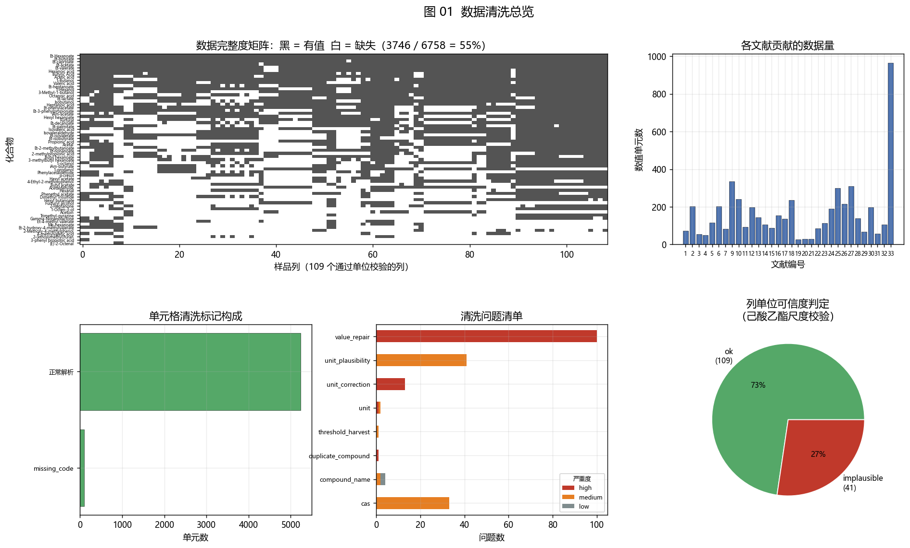

---

## 3. 关系挖掘

> 分析矩阵：**62 化合物 × 109 个通过校验的样品列**（其中 89 个样品列含有 ≥12 个关键化合物，用于多元分析）。
> 方法学原则：**秩统计（Spearman）对所有列有效**；**绝对单位与 OAV 只在 109 个通过校验的列上做**。

### 3.1 关键香气化合物的 20×20 相关矩阵（课题"备选方案"）

筛选规则（可复现）：**中位 OAV > 1 且被 ≥20 个可用列报道**，按中位 OAV 降序取前 20：

| 排名 | 化合物 | 类别 | 阈值 (μg/L) | 报道列数 | 中位 OAV |
|---|---|---|---|---|---|
| 1 | 己酸乙酯 | 酯 | 55.2 | 109 | 22 688 |
| 2 | 1-辛烯-3-醇 | 醇 | 0.0061 | 32 | 19 935 |
| 3 | 1-丙醇 | 醇 | 54.0 | 52 | 2 684 |
| 4 | 丁酸乙酯 | 酯 | 81.5 | 109 | 1 431 |
| 5 | 戊酸乙酯 | 酯 | 26.8 | 106 | 1 056 |
| 6 | 辛酸乙酯 | 酯 | 12.9 | 108 | 1 030 |
| 7 | 二甲基三硫醚 | 硫化物 | 0.38 | 37 | 329 |
| 8 | 异戊酸乙酯 | 酯 | 6.95 | 68 | 320 |
| 9 | 3-羟基-2-丁酮（乙偶姻） | 酮 | 259 | 24 | 132 |
| 10 | 异丁酸乙酯 | 酯 | 57.5 | 67 | 85.8 |
| 11 | 丁酸异戊酯 | 酯 | 20.0 | 53 | 75.6 |
| 12 | 丁酸 | 酸 | 964 | 102 | 53.4 |
| 13 | 戊酸 | 酸 | 389 | 98 | 47.8 |
| 14 | 2-甲基丁酸乙酯 | 酯 | 21.4 | 62 | 35.2 |
| 15 | 3-苯基丙酸乙酯 | 酯 | 125 | 80 | 27.9 |
| 16 | 己醛 | 醛 | 25.5 | 39 | 27.3 |
| 17 | 乙酸异戊酯 | 酯 | 93.9 | 80 | 19.9 |
| 18 | 乙醛 | 醛 | 1 200 | 42 | 17.5 |
| 19 | 乙酸乙酯 | 酯 | 32 600 | 108 | 15.6 |
| 20 | 1-丁醇 | 醇 | 2 730 | 98 | 11.2 |

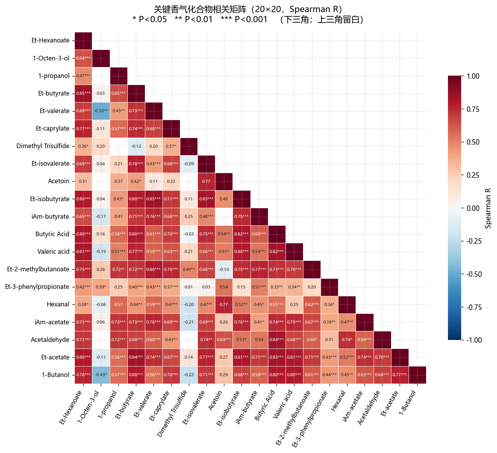

**读图要点**：

* **酯类之间形成强正相关团**：己酸乙酯—丁酸乙酯 R=0.85\*\*\*、丁酸乙酯—异丁酸乙酯 R=0.80\*\*\*、戊酸乙酯—2-甲基丁酸乙酯 R=0.80\*\*\*、辛酸乙酯—异丁酸乙酯 R=0.71\*\*\* —— 说明浓香型白酒的乙酯类**同源同向生成**（同一发酵/蒸馏/陈酿过程驱动），这与"酯类由己酸菌-酵母酯化体系共同产生"的机理一致。
* **酸类与酯类同向**：丁酸—异丁酸乙酯 R=0.82\*\*\*、戊酸—丁酸乙酯 R=0.77\*\*\*、乙酸乙酯—丁酸 R=0.83\*\*\* —— 酸是酯的前体，前体-产物同向变动，是**可直接用于勾兑调控的"联动变量对"**。
* **1-辛烯-3-醇与多个酯类负相关**：与戊酸乙酯 R=−0.50\*\*、与 1-丁醇 R=−0.43\* —— 呈现**此消彼长**关系，提示发酵条件（或稀释/陈酿）在两个方向上互相排斥。
* **二甲基三硫醚相对独立**（与多数酯类 R≈0.1–0.4），符合其"极低阈值、独立于酯类代谢"的化学行为。

**统计口径说明**：全库 62 化合物共 1 693 个可检配对，P<0.05 者 1 183 对；经 **Benjamini–Hochberg FDR 5%** 校正后仍有 **1 123 对**存活。但由于样品来自不同文献，**跨文献的相关会混入"文献间偏移"**，因此 §3.4 改用"文献内相关 + 跨文献一致性检验"来给出更稳健的结论。

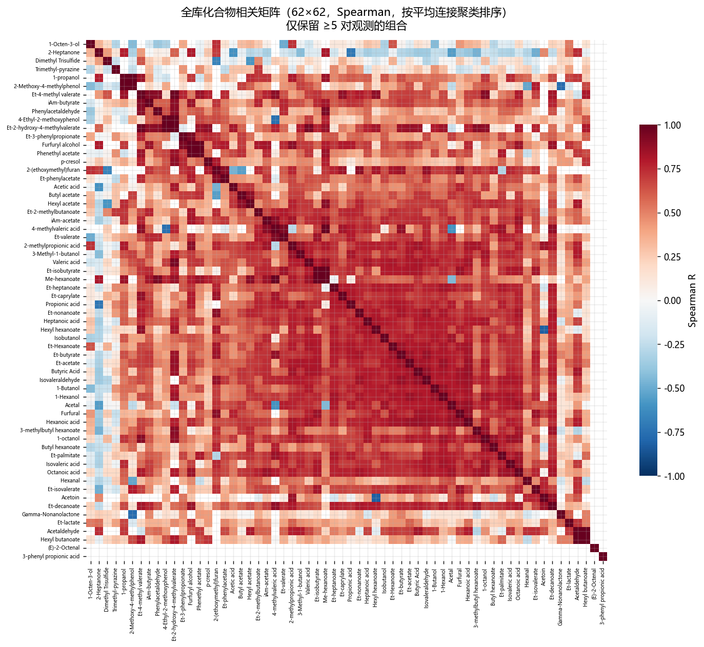

### 3.2 变量级层次聚类（课题"1.1 变量组"）

对 `1 − |Spearman R|` 做 Ward 连接聚类，在 5 类处切分（`compound_clusters.csv`）：

| 变量组 | 化合物数 | 成员 | 化学解读 |
|---|---|---|---|
| **组 1（短链乙酯 / 乙酸酯族）** | 10 | 戊酸乙酯、辛酸乙酯、异丁酸乙酯、2-甲基丁酸乙酯、4-甲基戊酸乙酯、己酸甲酯、乙酸异戊酯、丁酸异戊酯、4-甲基戊酸、丙酸 | **发酵早期生成、香气强度高**的支链/短链酯族 |
| **组 2（主体骨架）** | 35 | 己酸乙酯、乙酸乙酯、丁酸乙酯、乳酸乙酯、庚酸乙酯、癸酸乙酯、壬酸乙酯、棕榈酸乙酯、异戊酸乙酯、己酸、丁酸、乙酸、戊酸、庚酸、辛酸、异戊酸、1-丁醇、1-己醇、1-丙醇、1-辛醇、异丁醇、3-甲基-1-丁醇、己醛、异戊醛、糠醛、乙偶姻、乙酸丁酯、乙酸己酯、己酸丁酯、己酸己酯、己酸异戊酯、苯乙酸乙酯、2-(乙氧基甲基)呋喃、2-甲氧基-4-甲基苯酚、缩醛 | **浓香型白酒的核心风味集合**，占比最大 |
| **组 3（陈香 / 芳香族 / 酚醛）** | 10 | 苯乙醛、乙酸苯乙酯、3-苯基丙酸乙酯、4-乙基愈创木酚、对甲酚、三甲基吡嗪、糠醇、乙醛、2-羟基-4-甲基戊酸乙酯、丁酸己酯 | **"糟香 / 窖香 / 烘焙香"** 的化学载体 |
| **组 4（痕量高活性）** | 5 | 二甲基三硫醚、1-辛烯-3-醇、2-庚酮、乳酸乙酯、γ-壬内酯 | **极低阈值、极高 OAV**，彼此抱团 |
| **组 5（醛/酸小众）** | 2 | (E)-2-辛烯醛、3-苯基丙酸 | 样本量少，独立成组 |

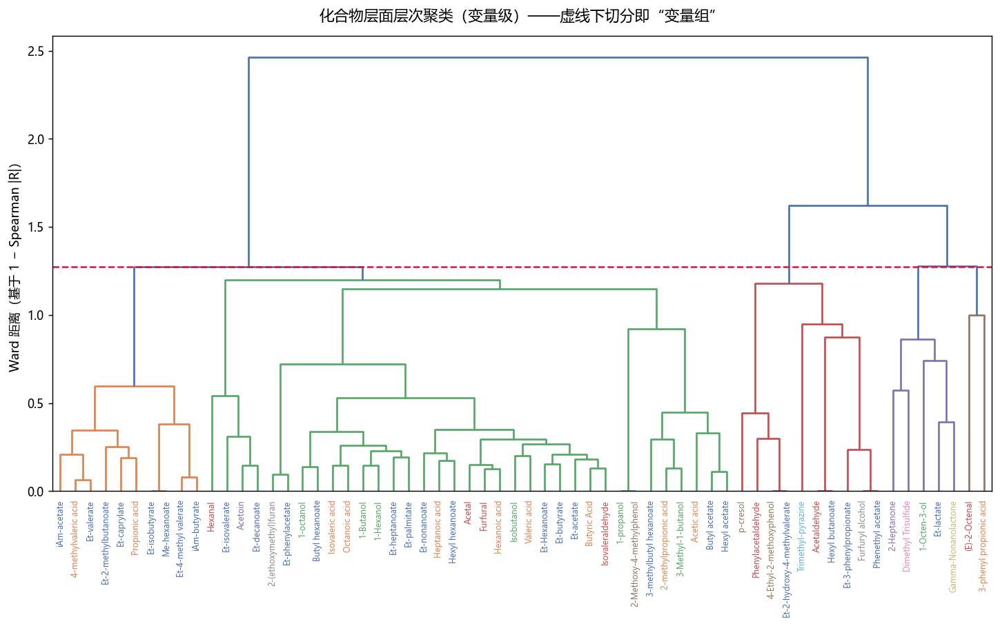

> **对课题的直接意义**：课题计划"在 20 个变量上做层次聚类，锁定树状图底部紧密聚类的几个化合物"。本次结果在 **62 个变量**上完成聚类，20 个关键化合物主要落在**组 1、组 2、组 4**：
>
> * **组 4（二甲基三硫醚、1-辛烯-3-醇、γ-壬内酯、乳酸乙酯、2-庚酮）** 与主体酯类弱相关、但 OAV 极高 —— **独立信息量最大，最适合作为符号回归的"小变量组"起点**；
> * **组 1 与组 2 内部相关极高**（多条 R>0.8），说明存在**共线性**，做 PLSR/VIP 时会被此稀释，建议按组降维后再建模；
> * **组 3（芳香族/酚类）** 跨越了酯-酸-醇类别，是"香气描述符（糟香/窖香）↔ 化合物"映射的关键候选，与课题计划中"焦香↔吡嗪、糟香↔4-乙基愈创木酚"的描述符体系直接对应。

### 3.3 样品空间：PCA 与 DBSCAN

对 89 个样品 × 20 关键化合物（log₁₀ 后 z-score 标准化，缺失以中位数填补）：

* **PC1 = 48.1%，PC2 = 8.9%，合计 56.9%** —— PC1 主要区分"酯类骨架丰度"层级，PC2 区分"芳香族/酚类/醛类"方向；
* 载荷图上 **乙偶姻、己醛、乙醛、3-苯基丙酸乙酯** 主导 PC2 正方向，**二甲基三硫醚、1-辛烯-3-醇** 在 PC1 负方向 —— 与 §3.2 的组 4/组 5 结论一致。

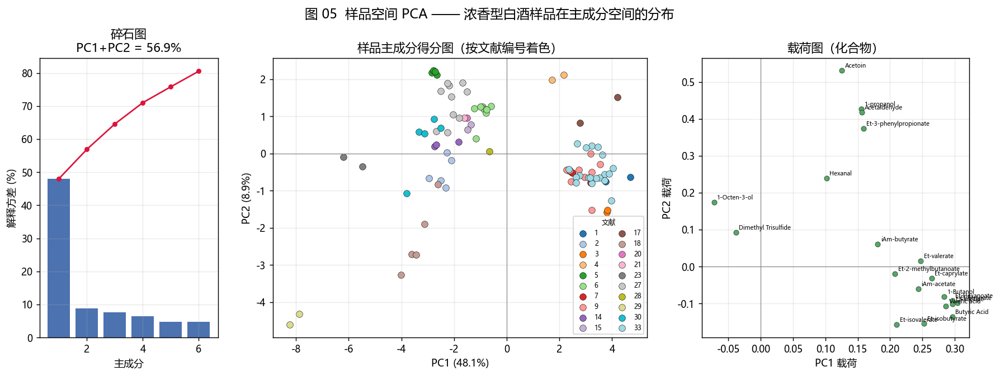

**DBSCAN（课题"1.2 有效样本簇"）**：eps=2.28（5-近邻 k-距离拐点）、min_samples=4 → **7 个簇 + 28 个离群样本（31.5%）**。

* **有效样本簇**：最大簇 25 个样品，其余 4–11 个；
* **离群样本**：主要来自单位异常的文献组（24/25/32/33）与"重组模型酒"（文献 10）—— 也就是说 **DBSCAN 的离群判据与 §2.6 的单位异常判据互相独立地指向了同一批样品**，这从两个角度交叉验证了数据质量问题。

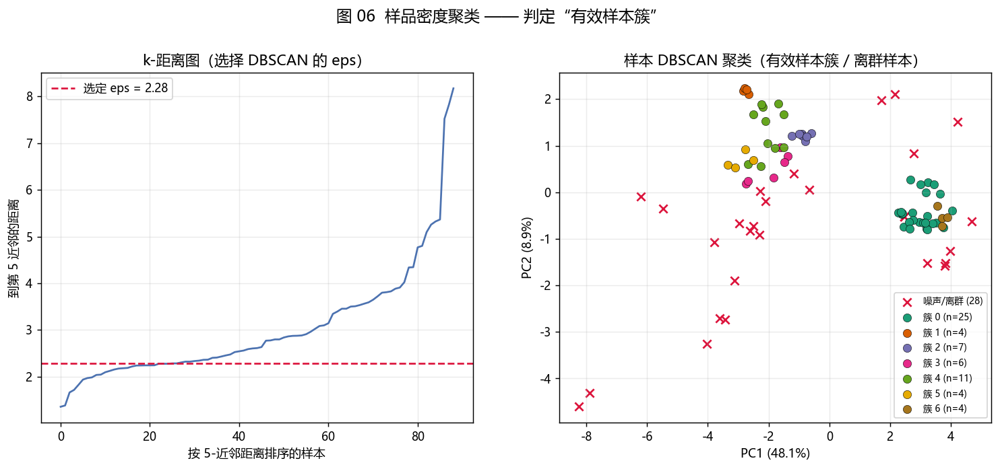

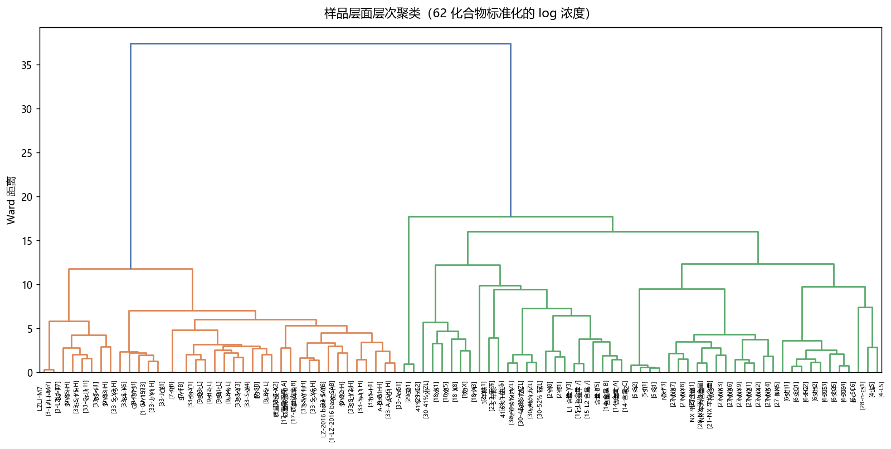

### 3.4 化合物共现网络（文献内相关 + 跨文献一致性检验）

**方法**：先在**每篇文献内部**计算化合物对之间的 Spearman 相关（避免文献间偏移污染），再用 **Fisher z 合并 + Stouffer 法**检验跨文献一致性。1 219 个化合物对在 ≥2 篇文献中被报道；要求 **≥3 篇文献同向、符号一致率 ≥99%、|平均 R| ≥ 0.6**，得到 **34 条稳健边**。

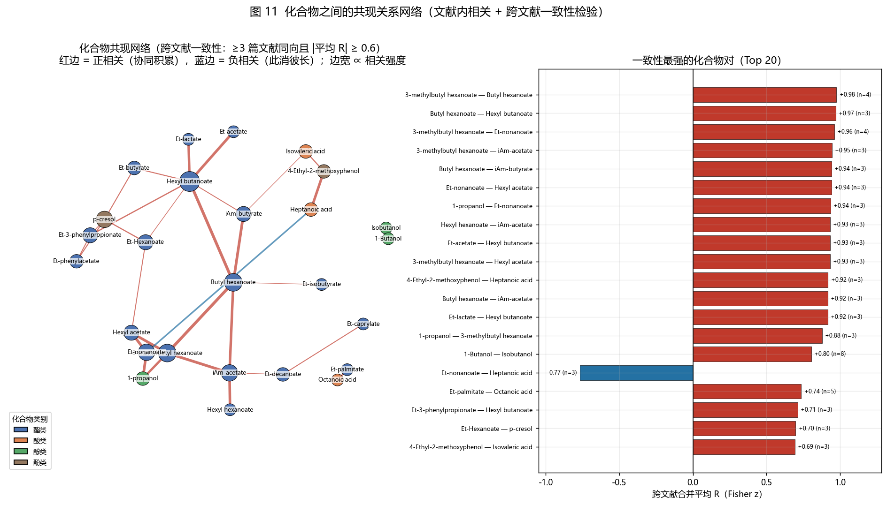

**一致性最强的化合物对（Top 12）**：

| 化合物 A | 化合物 B | 文献数 | 平均 R |
|---|---|---|---|
| 3-甲基丁基己酸酯 | 己酸丁酯 | 4 | +0.98 |
| 己酸丁酯 | 己酸己酯 | 3 | +0.97 |
| 3-甲基丁基己酸酯 | 壬酸乙酯 | 4 | +0.96 |
| 3-甲基丁基己酸酯 | 乙酸异戊酯 | 3 | +0.95 |
| 己酸丁酯 | 丁酸异戊酯 | 3 | +0.94 |
| 壬酸乙酯 | 乙酸己酯 | 3 | +0.94 |
| 1-丙醇 | 壬酸乙酯 | 3 | +0.94 |
| 己酸己酯 | 乙酸异戊酯 | 3 | +0.93 |
| **壬酸乙酯 ↔ 庚酸** | **负相关** | 3 | **−0.77** |
| 棕榈酸乙酯 | 辛酸 | 5 | +0.74 |

**这是本报告中最可复现、最可信的关系结论**：它们在**多篇独立文献**中同向出现，而不是单一数据集的偶然相关。可用于：

* **勾兑联动**：正相关对（如"己酸丁酯—己酸己酯"）在调酒时会同向变化，可作为一个调控单元；
* **反向约束**：负相关对（如"壬酸乙酯—庚酸"）可作为配方寻优时的约束条件；
* **符号回归的初始变量组**：优先在正相关团内部寻找比值关系（课题提到的"存在比例关系的化合物集合"）。

### 3.5 阈值 → 浓度 → OAV：谁在真正贡献香气

把 55 个有阈值的化合物放在"阈值—中位浓度"对数平面上：

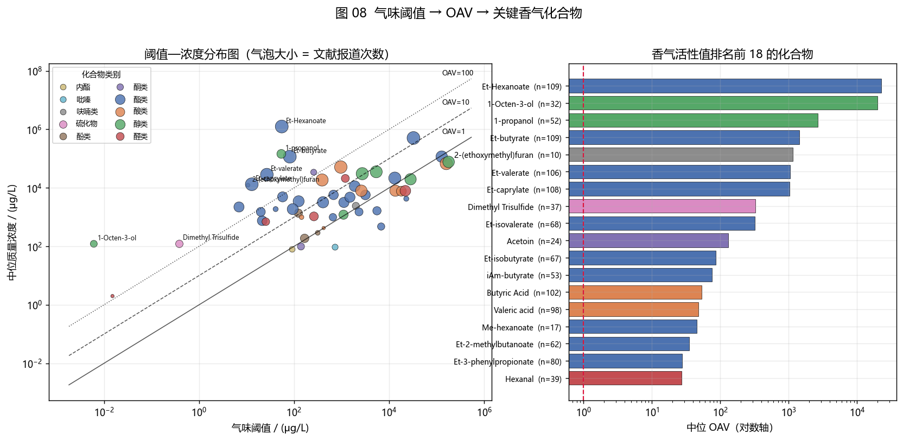

* **左上角（低阈值、高浓度）才是真正的关键香气物质**：己酸乙酯、1-辛烯-3-醇、二甲基三硫醚、异戊酸乙酯、戊酸乙酯、辛酸乙酯；
* **己酸乙酯是唯一的"双高"物质**：中位 OAV ≈ 2.3×10⁴，且在 **109/109 个可用列中全部被报道**，是数据库中唯一全覆盖的化合物 —— 这与"己酸乙酯是浓香型白酒的骨架与标志物"完全一致；
* **1-辛烯-3-醇虽然只有 32 列报道，但中位 OAV ≈ 2.0×10⁴**，是潜力被低估的化合物（阈值仅 0.0061 μg/L），**建议在后续感官实验中单独关注**；
* **二甲基三硫醚**（阈值 0.38 μg/L）中位 OAV ≈ 329，是典型的"痕量高活性"物质，与 §3.2 的组 5 对应；
* 反过来，**乙酸乙酯虽浓度最高（10⁵–10⁶ μg/L 量级），但阈值高达 32 600 μg/L，中位 OAV 仅 15.6** —— 说明"含量高 ≠ 贡献大"，**这正是课题需要用 OAV 而非浓度筛选变量的理由**。

### 3.6 风味贡献权重表（课题的最终交付物雏形）

对每个样品计算 **相对 OAV 占比**：`w_i = OAV_i / Σ OAV`（每个样品内部归一化到 100%），再对所有含该化合物的样品取平均，得到可直接用于勾兑配比讨论的**风味贡献权重表**：

| 化合物 | 平均贡献权重 | 覆盖样品数 | 类别 |
|---|---|---|---|
| **己酸乙酯** | **47.4%** | 109 | 酯 |
| **1-辛烯-3-醇** | **45.7%** | 32 | 醇 |
| 戊酸乙酯 | 11.1% | 106 | 酯 |
| 1-丙醇 | 9.0% | 52 | 醇 |
| 辛酸乙酯 | 8.4% | 108 | 酯 |
| 丁酸乙酯 | 5.3% | 109 | 酯 |
| 3-苯基丙酸乙酯 | 4.3% | 80 | 酯 |
| 2-(乙氧基甲基)呋喃 | 3.7% | 10 | 呋喃 |
| 二甲基三硫醚 | 3.5% | 37 | 硫化物 |
| 异戊酸乙酯 | 3.3% | 68 | 酯 |

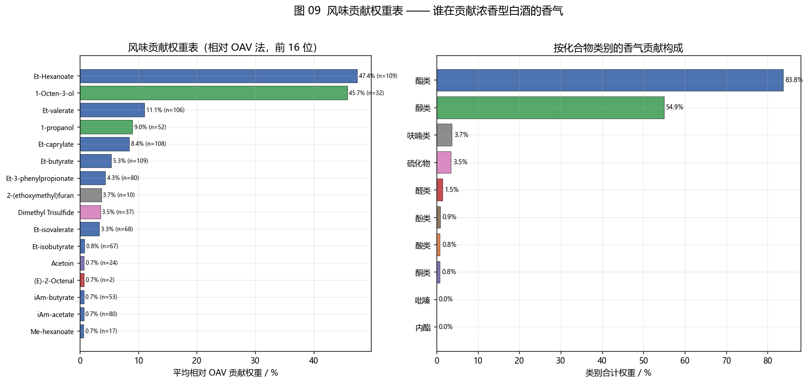

**解读**：

* **己酸乙酯是第一贡献者**（在 109 个样品上平均占 47.4%），且是数据库中唯一全覆盖的化合物；
* **1-辛烯-3-醇以 32 个样品就达到 45.7% 的平均权重** —— 说明在**它被检出的那些样品里**它几乎与己酸乙酯平分香气活性，是"少而强"的典型；
* 其余物质均在 1–11% 量级，构成"长尾"；
* 表内各项权重**分别在不同样品子集上求平均**，因此合计 >100%（合计约 150%）；若需要严格归一化的"单样品权重向量"，请用逐样品占比矩阵 `oav_share_matrix.csv`（每列精确和为 100%）。

> ⚠️ 方法学限制：本权重是**相对 OAV 法**（假设各化合物香气强度可线性可加），并未考虑协同/掩蔽。课题计划的符号回归正是用来检验这一假设的工具 —— 因此本表应作为**符号回归与泰勒展开的基线与对照**，而非最终结论。完整表见 `oav_weights.csv`。

### 3.7 化合物 × 文献景观与类别构成

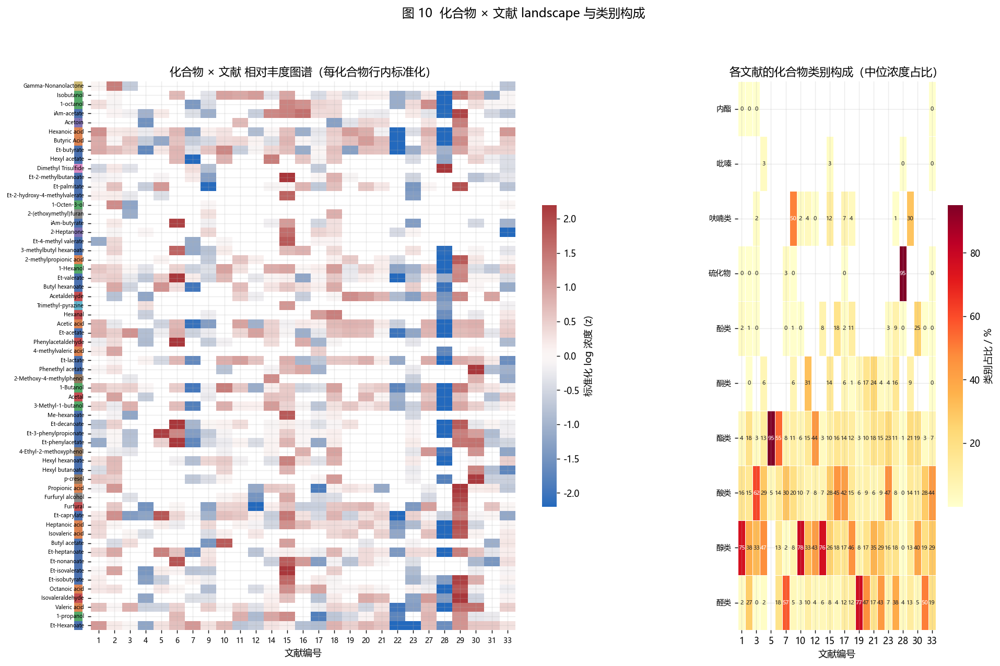

* 行内标准化后可以清楚看到：**酯类在多数文献中都是高丰度主体**，而**酚类、呋喃、硫化物、吡嗪**只在少数文献中被检出；
* 各文献的**类别构成差异很大**（右下热图）：有的以酯类占比 >80%，有的酸类占比显著 —— 这既反映真实样品差异，也反映**不同文献的检测方法/定量策略差异**（HS-SPME vs LLE vs GC×GC 对极性物质回收率不同）。
* **对课题的意义**：把"检测方法"作为协变量标注进数据库是必要的（课题方案已要求），否则模型会学到方法偏差而非酒体差异。

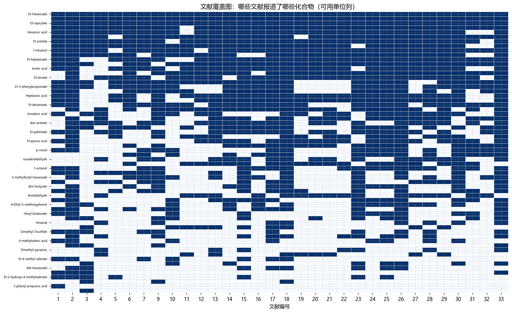

### 3.8 陈酿轴：趋势与 PLSR-VIP 示范

数据库中唯一存在的连续 Y 是**陈酿年份**（文献 2 的 Y1/Y3/Y5/Y8/Y11、文献 18 的 X0–X8），共 10 个可用样品（8 个年份点）。

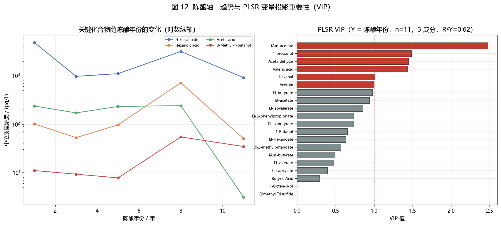

* **趋势**：己酸乙酯、己酸、3-甲基-1-丁醇在陈酿过程中总体**先升后降或波动**，乙酸则相对稳定；辛酸乙酯等中长链酯在 8 年附近出现峰值 —— 与"酯化-水解动态平衡"的文献结论方向一致。曲线有波动，说明**样品量太少（n=10），趋势仅供定性参考**。
* **PLSR/VIP**（Y = 陈酿年份，3 个成分，R²Y = 0.62）：VIP > 1 的变量为 **乙酸异戊酯（2.48）、1-丙醇（1.49）、乙醛（1.45）、戊酸（1.43）、己醛（1.01）、乙偶姻（1.00）**，可作为"年份敏感标志物"的候选。**n=10 且来自 2 篇文献，结果不具统计效力，仅作为方法链路的演示**。

> **要得到课题真正需要的 VIP 排名，必须补上感官强度 Y 矩阵**（见 §4.2）。

---

## 4. 结论与建议

### 4.1 最重要的数据缺口：整合率只有 18%

| 项目 | 数量 |
|---|---|
| 主库 `all data` 已整合的化合物 | **62** |
| 12 个文献工作表里出现的不同化合物名 | **341** |
| 能匹配上主库的 | 60（**18%**） |
| **未整合进主矩阵的化合物** | **281** |

各文献工作表的化合物数量：文献 5 有 **119** 个、文献 5(PEF) 有 **91** 个、文献 3 有 65 个…… 而主库总共只有 62 行。**大量已录入的数据散落在工作表里，没有进入主矩阵**，这直接限制了"150 条样本 × 20 个化合物"的目标。

此外，文献工作表中的化合物名存在**系统性字符损坏**，例如 `1-Brussol` / `2-Brussol`（应为 1-/2-**Butanol**）、`1,2-benzachol`、`2-Peramolium`、`Pantrol`、`1 1 dichlorypentine` 等 —— 看起来像一次全局查找替换或 OCR 错误。**这批名称需要先修复才能整合。**

### 4.2 建议的下一步（按优先级）

| 优先级 | 任务 | 依据 |
|---|---|---|
| **P0** | **补齐感官 Y 矩阵**（QDA/RATA 描述符强度）。没有 Y，PLSR/VIP、符号回归、泰勒展开都无法真正执行 | §1.3、§3.8 |
| **P0** | 修复文献工作表中的损坏化合物名（`Brussol`→`Butanol` 等）并**把 281 个未整合化合物并入主矩阵** | §4.1 |
| **P1** | 核对 §2.6 的 41 列单位（尤其文献 24/25 疑似应为 mg/L，文献 13/32 疑似 g/L 标注有误），核对后把 `usable_absolute` 从 109 列扩到约 130 列 | §2.6 |
| **P1** | 把**产区/品牌/工艺/检测方法**四个标签正式建成列（文献 24/25/30/32 已有对应样品名） | 课题方案要求 |
| **P2** | 统一 OAV≈1 附近化合物的阈值（课题学期计划第 1 项），本报告的 `thresholds_consensus.csv` 已给出多来源范围可直接用于敏感性分析 | §2.5 |
| **P2** | 用 §3.2 的变量组 + §3.4 的稳健相关对作为**符号回归的初始变量组**，优先在组 4/组 5 内寻找非线性交互 | §3.2、§3.4 |
| **P3** | 把 §3.6 的权重表作为"权重法配比"，与"OAV 法配比"对比（课题第 3 个拟解决问题） | §3.6 |

### 4.3 清洗过程中发现、需要作者确认的问题

1. **CAS 列曾经过一次删除所有 `0` 的破坏**（33 行）—— 建议同时保留一份原始 CSV 作为对照。
2. `Threshold` 与 `Concentration（μg/L）` 两列**从未填写**，是否计划废弃？
3. 文献 2 / 文献 6 组的单位在主库被写成 μg/L、在姊妹库写成 μg/ml，**已按姊妹库修正为 mg/L**。
4. 主库与姊妹库的 `all data` **列顺序不同**（主库文献 4/6/7/9 为浓度，姊妹库同位置为 OAV），合并时必须按列名而非位置对齐。
5. `Sheet9` 为空表；`4  LS` 与 `4  LS `、`LZ1-1` 出现两次、`NX1` 出现两次 —— 存在重复/歧义列名。

---

## 5. 产出清单与复现方法

### 5.1 目录结构（全部在 `new/` 下）

```
new/
├─ cleanlib.py                      共享清洗原语（CAS 校验/数值解析/单位/分类）
├─ 10_extract_sources.py            文献工作表 → 整洁长表
├─ 20_clean_master.py               主库清洗（CAS/名称/单位/数值修复/阈值/OAV）
├─ 30_analyze.py                    关系挖掘 + 全部绘图
├─ 40_export_excel.py               汇总导出 Excel
├─ 白酒风味数据库_清洗版.xlsx        ★ 32 个工作表的汇总成果
├─ 数据清洗与关系挖掘报告.md         ★ 本报告
├─ figures/                          ★ 13 张图（fig01–fig13）
├─ output/                           全部中间与最终 CSV + 数据质量报告
└─ scratch/                          调试脚本与文献上下文笔记（非交付物）
```

### 5.2 关键产出文件

| 文件 | 内容 |
|---|---|
| `output/data_quality_report.md` | 数据质量报告（自动生成，含逐项统计） |
| `output/compound_master.csv` | 62 个化合物主表（CAS、SMILES、类别、阈值） |
| `output/column_registry.csv` | 156 列登记表（文献/样品/单位/可信度/可用性） |
| `output/master_long.csv` | 全库整洁长表（5 330 个单元，含 μg/L 与 OAV） |
| `output/master_wide_ugL.csv` | 宽表（统一 μg/L，可直接建模） |
| `output/issues_log.csv` | 195 条清洗问题日志（可审计） |
| `output/thresholds_consensus.csv` | 55 个化合物的阈值共识（多来源中位数/min/max） |
| `output/oav_summary.csv` | OAV 汇总（40 个化合物中位 OAV>1） |
| `output/corr_key20_R.csv` / `_P.csv` | **20×20 相关矩阵与 P 值** |
| `output/consensus_correlations.csv` | 1 219 对文献内相关 + 跨文献一致性检验 |
| `output/network_edges.csv` | 34 条稳健共现边 |
| `output/compound_clusters.csv` | 变量级聚类（5 组） |
| `output/sample_scores.csv` / `dbscan_labels.csv` | 样品 PCA / DBSCAN 结果 |
| `output/oav_weights.csv` | **风味贡献权重表** |
| `output/unit_plausibility.csv` | 逐列单位可信度判定与待核对清单 |

### 5.3 复现

```powershell
$py = "C:\anaconda\python.exe"      # 含 matplotlib / seaborn / scipy / sklearn / networkx
& $py new\10_extract_sources.py     # 文献工作表解析
& $py new\20_clean_master.py        # 主库清洗
& $py new\30_analyze.py             # 关系挖掘 + 出图
& $py new\40_export_excel.py        # 汇总 Excel
```

全部脚本**只读**打开 `data总库.xlsx` 与 `data.xlsx`，所有写入都发生在 `new/` 内。

### 5.4 图目录

| 图 | 文件 | 内容 |
|---|---|---|
| 01 | `fig01_cleaning_overview.png` | 清洗总览（完整度矩阵、各文献数据量、清洗标记、问题清单、单位可信度） |
| 02 | `fig02_corr20_significance.png` | **20×20 关键化合物相关矩阵（含显著性）** |
| 03 | `fig03_corr_full_clustered.png` | 62×62 全库聚类相关矩阵 |
| 04 | `fig04_dendrogram_compounds.png` | **变量级层次聚类树状图（5 个变量组）** |
| 05 | `fig05_pca_samples.png` | 样品 PCA（碎石图 / 得分图 / 载荷图） |
| 06 | `fig06_dbscan_samples.png` | **DBSCAN 样品聚类（有效样本簇 / 离群）** |
| 07 | `fig07_sample_dendrogram.png` | 样品层次聚类 |
| 08 | `fig08_threshold_oav.png` | **阈值—浓度—OAV 分布与关键香气化合物排名** |
| 09 | `fig09_flavor_weights.png` | **风味贡献权重表（相对 OAV 法）** |
| 10 | `fig10_compound_study_landscape.png` | 化合物 × 文献景观 + 类别构成 |
| 11 | `fig11_correlation_network.png` | **化合物共现网络（跨文献一致性检验）** |
| 12 | `fig12_aging_vip.png` | 陈酿趋势 + PLSR VIP |
| 13 | `fig13_coverage_map.png` | 文献覆盖图（哪些文献报道了哪些化合物） |
